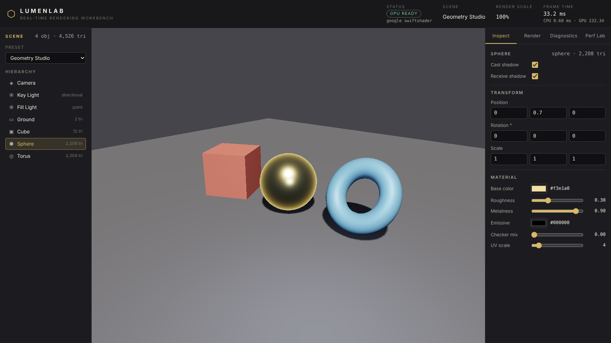
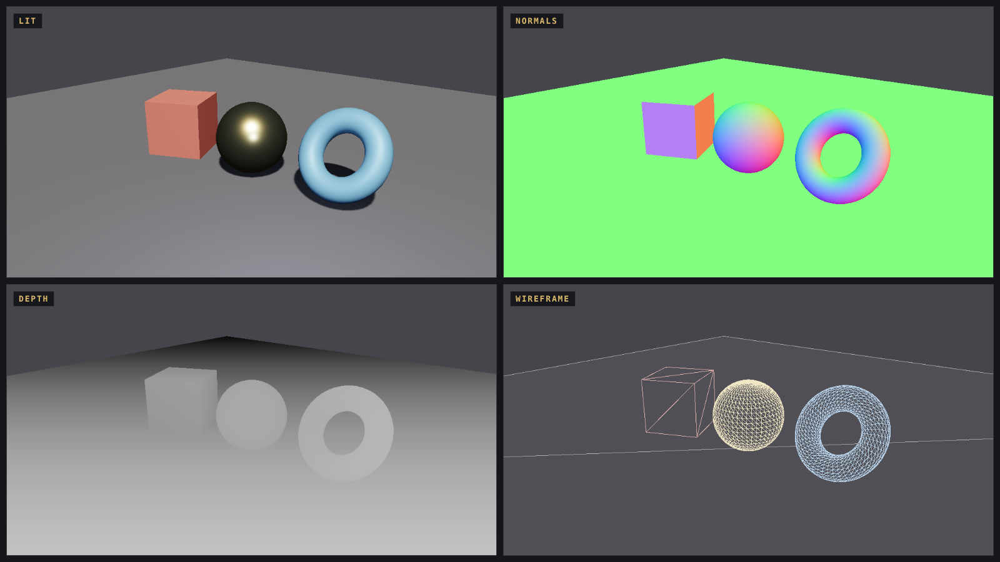
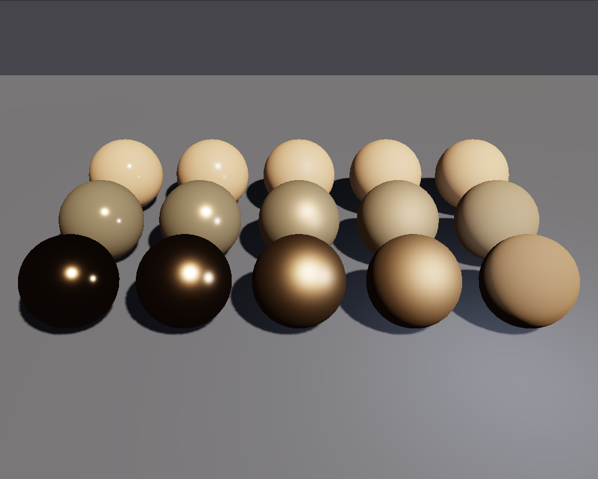
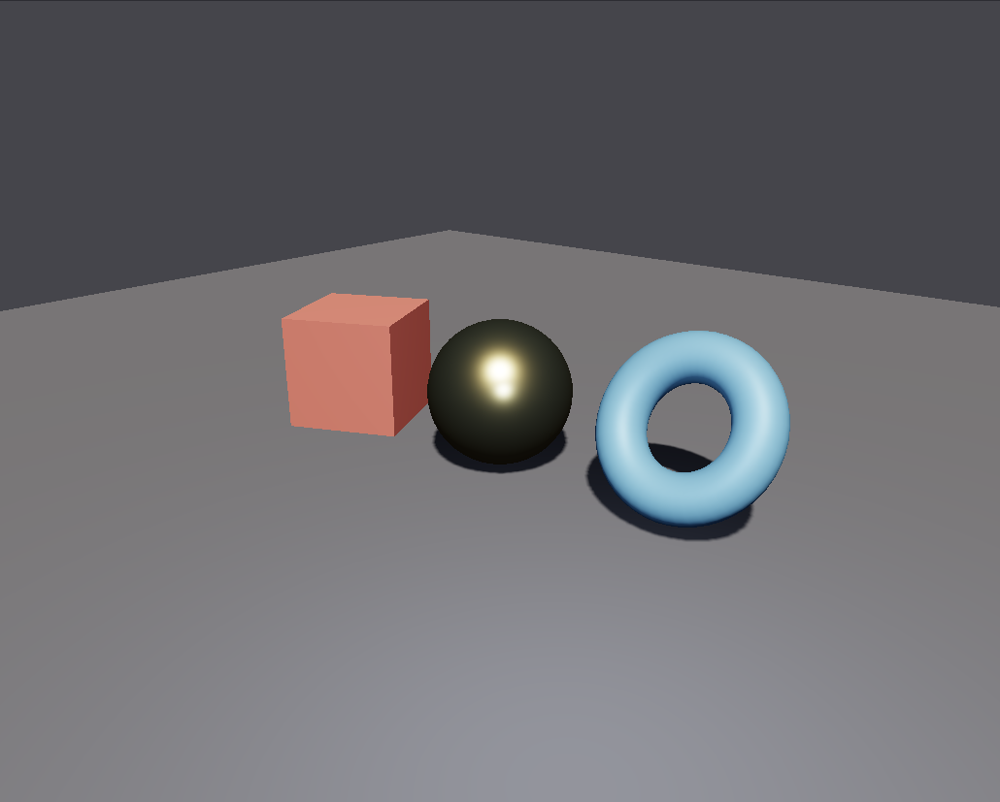
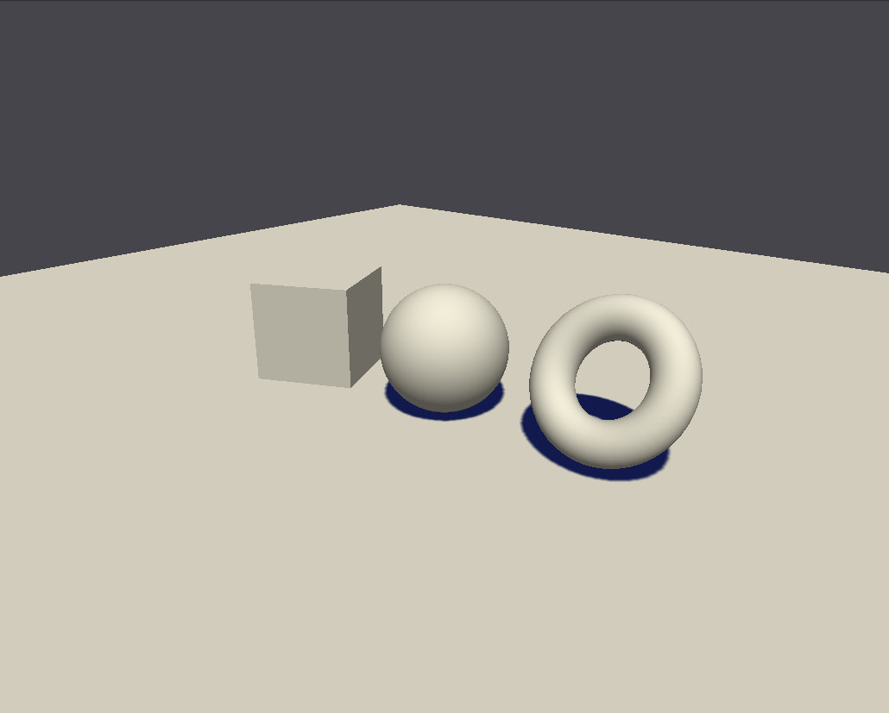
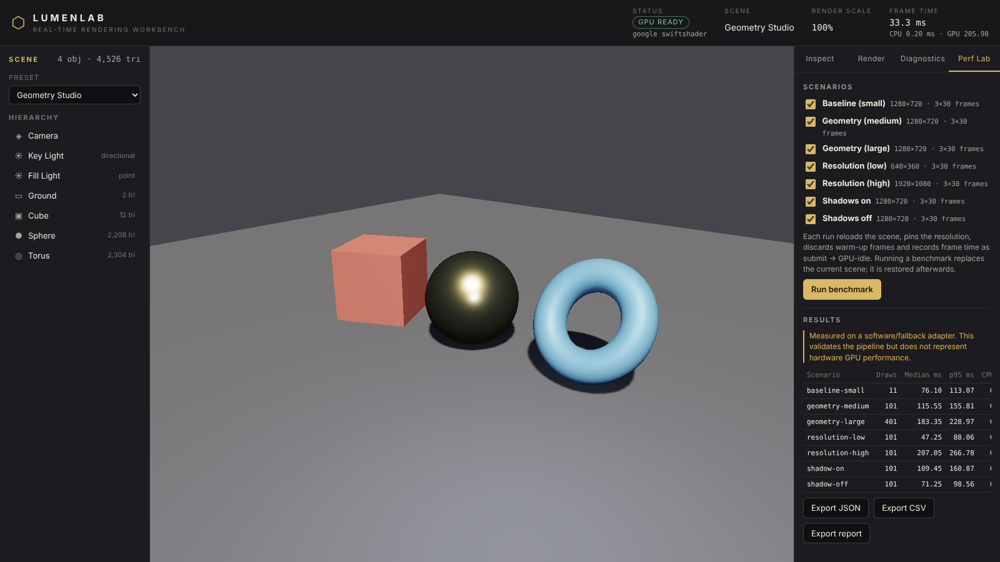
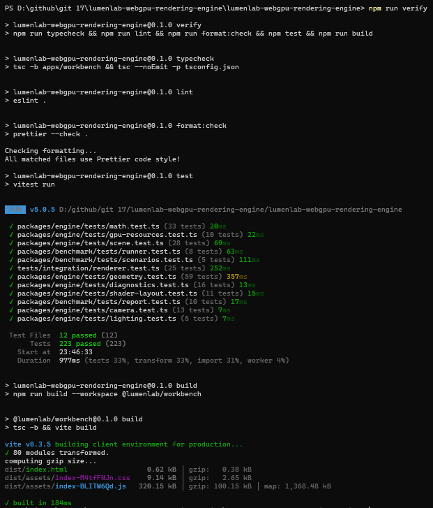
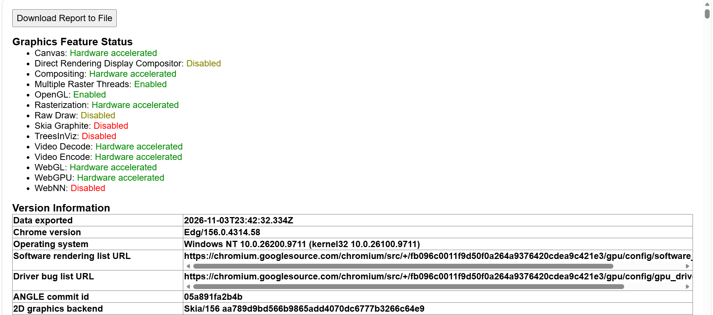
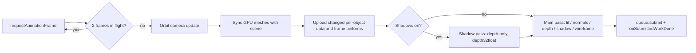

<div align="center">

# LumenLab

**A from-scratch real-time 3D rendering engine and interactive WebGPU workbench.**
Written in TypeScript and WGSL - no Three.js, no Babylon.js, no 3D library of any kind.




</div>

> **About the images.** The renderings in this README were captured from the running application
> by `npm run screenshots` in a headless Chromium using the **SwiftShader software WebGPU
> adapter** (the header reads "google swiftshader"). They demonstrate rendering correctness, not GPU
> performance. Evidence from a real machine is shown separately in
> [Verified environments](#verified-environments).

LumenLab is an engineering project, not a 3D website. The maths, the scene graph, the procedural
geometry, the WGSL shaders, the shadow-mapping pass and the GPU resource management are all written
in this repository. React draws the user interface, Vite builds it, Vitest and Playwright test it,
and nothing else is involved in producing a pixel.

## Contents

- [Highlights](#highlights)
- [Gallery](#gallery)
- [Verified environments](#verified-environments)
- [Quick start](#quick-start)
- [Using the workbench](#using-the-workbench)
- [Engine API](#engine-api)
- [Architecture](#architecture)
- [Rendering features](#rendering-features)
- [Testing](#testing)
- [Benchmarks](#benchmarks)
- [Troubleshooting](#troubleshooting)
- [Limitations](#limitations)
- [Roadmap](#roadmap)
- [Repository layout](#repository-layout)
- [Documentation](#documentation)
- [Contributing and license](#contributing-and-license)

## Highlights

| Area            | What you get                                                                                            |
| --------------- | ------------------------------------------------------------------------------------------------------- |
| **Engine**      | Own vector / quaternion / matrix maths, scene graph, orbit camera, procedural meshes, materials, lights |
| **Rendering**   | WebGPU pipeline in WGSL: PBR-style shading, depth testing, shadow mapping with PCF, five view modes     |
| **Workbench**   | React UI: 3D viewport, hierarchy, inspector, render settings, live diagnostics, Performance Lab         |
| **Evaluation**  | Seven one-factor-at-a-time benchmark scenarios, statistics, schema-validated JSON / CSV / Markdown      |
| **Engineering** | 223 unit and integration tests, 13 browser tests, strict TypeScript, ESLint, Prettier, CI, 9 ADRs       |
| **Honesty**     | No fallback renderer, no invented numbers, software-adapter results are labelled as such                |

The central rule: **React never creates a GPU buffer and never owns a render loop.** The UI sends
typed commands to `Engine` and reads typed state back; an ESLint rule stops the engine from
importing React at all.

## Gallery

### Lit scene and diagnostic view modes

Every view mode is produced by its own path in the real shader, not by recolouring the lit image.

<div align="center">

</div>

| Mode          | What it shows                                                                             |
| ------------- | ----------------------------------------------------------------------------------------- |
| **Lit**       | Cook-Torrance shading, one shadowed directional light plus point lights                   |
| **Normals**   | World-space normals mapped to RGB, written without gamma so the picture is the data       |
| **Depth**     | Linear view-space depth normalised by the camera's near and far planes                    |
| **Wireframe** | Unique triangle edges as a line list over a depth-writing fill, so hidden edges disappear |
| **Shadow**    | The shadow-map visibility term as a colour ramp (shadowed regions are blue)               |

### Materials

Five roughness steps (left to right, glossy to rough) by three metalness steps (back row dielectric,
front row metal), lit by the same key and fill lights.

<div align="center">

</div>

### Geometry and shadows

<table>
  <tr>
    <td align="center"><br><sub><b>Geometry Studio</b> - procedural cube, sphere and torus, PCF shadows</sub></td>
    <td align="center"><br><sub><b>Shadow view</b> - shadow-map visibility rendered as a colour ramp</sub></td>
  </tr>
</table>

### Performance Lab

Pick scenarios, run them, read the median / p95 table, and export JSON, CSV or a Markdown report.
The banner appears automatically when the adapter is a software one.

<div align="center">

</div>

## Verified environments

Claims in this repository are limited to what has actually been run. This table is the complete
record.

| Environment                                                   | Command            | Result                                                         | Evidence                                     |
| ------------------------------------------------------------- | ------------------ | -------------------------------------------------------------- | -------------------------------------------- |
| Linux container, Node 22, Chromium + SwiftShader (software)   | `npm run verify`   | typecheck, lint, format, 223 tests, build: pass                | CI-equivalent run, fresh clone               |
| Linux container, Chromium + SwiftShader                       | `npm run test:e2e` | 13 of 13 pass                                                  | Playwright output                            |
| Linux container, Chromium + SwiftShader                       | `npm run bench`    | 7 scenarios x 3 runs, flagged `softwareAdapter`                | [`benchmarks/results/`](benchmarks/results/) |
| **Windows (NT 10.0.26200), Microsoft Edge 156, hardware GPU** | `npm run verify`   | typecheck, lint, format, **223 tests (12 files)**, build: pass | screenshot below                             |
| Windows, Edge 156                                             | `edge://gpu`       | **WebGPU: Hardware accelerated**                               | screenshot below                             |

<table>
  <tr>
    <td align="center"><br><sub><code>npm run verify</code> on Windows PowerShell</sub></td>
    <td align="center"><br><sub><code>edge://gpu</code>: WebGPU hardware accelerated, Edg/156</sub></td>
  </tr>
</table>

Not yet recorded: browser tests on Windows (they need Playwright's browser download, see
[Troubleshooting](#troubleshooting)), a benchmark run on a hardware GPU, and GitHub Actions /
GitHub Pages results (they need the repository to be pushed). The full list with evidence is in the
[release checklist](docs/release-checklist.md).

## Quick start

### Requirements

- **Node.js 22.12 or newer** and npm
- Git
- A WebGPU-capable browser: recent **Chrome or Edge**. WebGPU needs a secure context, and
  `http://localhost` qualifies. Having the API does not guarantee your GPU or driver will hand out an
  adapter; LumenLab reports exactly which step failed and never substitutes another renderer.

### Windows (PowerShell) with VS Code

```powershell
node --version        # v22.12 or newer
git clone https://github.com/<your-username>/lumenlab-webgpu-rendering-engine.git D:\github\lumenlab-webgpu-rendering-engine
Set-Location D:\github\lumenlab-webgpu-rendering-engine
code .

npm ci
npm run dev           # http://localhost:5173
```

### macOS / Linux

```bash
git clone https://github.com/<your-username>/lumenlab-webgpu-rendering-engine.git
cd lumenlab-webgpu-rendering-engine
npm ci
npm run dev
```

Open <http://localhost:5173>. The header shows **GPU READY** and your adapter name once the engine
has started. Without WebGPU you get a notice naming the failing step, not a blank page.

> Keep the repository **one folder deep** (`...\lumenlab-webgpu-rendering-engine`, not
> `...\lumenlab-webgpu-rendering-engine\lumenlab-webgpu-rendering-engine`) so that `git` commands
> and CI paths mean what you expect.

### Scripts

| Command                | What it does                                                             |
| ---------------------- | ------------------------------------------------------------------------ |
| `npm run dev`          | Vite dev server for the workbench                                        |
| `npm run build`        | Type-check and build to `apps/workbench/dist`                            |
| `npm run preview`      | Serve the production build locally                                       |
| `npm test`             | Unit and integration tests (Vitest, no GPU needed)                       |
| `npm run test:e2e`     | Browser tests (Playwright; run `npx playwright install chromium` first)  |
| `npm run typecheck`    | `tsc` over the workbench project and over every package, test and script |
| `npm run lint`         | ESLint, including the rule that the engine may not import React          |
| `npm run format:check` | Prettier check (`npm run format` fixes)                                  |
| `npm run verify`       | typecheck + lint + format check + tests + build                          |
| `npm run bench`        | Run the benchmark scenarios in a real browser and write results          |
| `npm run screenshots`  | Capture the images in `docs/images/` from the running app                |

## Using the workbench

| Where           | What you can do                                                                                                                                              |
| --------------- | ------------------------------------------------------------------------------------------------------------------------------------------------------------ |
| **Viewport**    | Left-drag orbits, right-drag or Shift + left-drag pans, wheel zooms, click selects. **Reset** restores the scene camera.                                     |
| **Scene panel** | Choose a preset (Geometry Studio, Material Gallery, Scale Test). The hierarchy lists camera, lights and meshes with triangle counts.                         |
| **Inspect**     | Meshes: shadow flags, position / rotation / scale, base colour, roughness, metalness, emissive, checker mix, UV scale. Lights: direction, colour, intensity. |
| **Render**      | View mode, shadows on or off, shadow-map size (512 to 4096), render scale (0.25x to 2x).                                                                     |
| **Diagnostics** | Adapter and limits, draw calls, triangles, uploads, GPU resource counts and bytes, timing, event log.                                                        |
| **Perf Lab**    | Select scenarios, run, read the results, export JSON / CSV / report. The previous scene is restored afterwards.                                              |

Open the app with `?debug` to expose `window.__lumenlab`, which the end-to-end tests use.

## Engine API

The UI depends only on this facade (`packages/engine/src/core/engine.ts`).

```ts
import { Engine, EngineError, geometryStudioScene } from "@lumenlab/engine";

try {
  const engine = await Engine.create(canvas); // throws EngineError("webgpu-unavailable" | ...)
  engine.loadScene(geometryStudioScene());

  engine.setMaterial("sphere", { baseColor: [0.8, 0.2, 0.1], roughness: 0.45, metalness: 0.1 });
  engine.setRenderSettings({ mode: "lit", shadowsEnabled: true, renderScale: 1 });
  engine.setTransform("cube", { position: [0, 0.5, 0], rotationDegrees: [0, 30, 0] });

  engine.onFrame.subscribe((stats) => console.log(stats.drawCalls, stats.triangles));
  engine.start(); // requestAnimationFrame loop with back-pressure
  // ...
  engine.dispose(); // stops the loop, destroys every GPU resource, idempotent
} catch (error) {
  if (error instanceof EngineError) showNotice(error.code, error.message);
}
```

The package also exports the maths (`Vector3`, `Quaternion`, `Matrix4`), geometry generators,
`Scene` and `SceneDefinition`, `OrbitController`, `Renderer` and the diagnostics utilities, so each
layer can be used and tested on its own.

## Architecture

```
┌──────────────────────────────────────────────────────────────┐
│ apps/workbench      React UI · scene tree · inspector · Lab   │
├──────────────────────────────────────────────────────────────┤
│ packages/benchmark  scenarios · runner · statistics · reports │
├──────────────────────────────────────────────────────────────┤
│ packages/engine     maths · scene · geometry · renderer · WGSL│
├──────────────────────────────────────────────────────────────┤
│ WebGPU              device · buffers · textures · pipelines   │
└──────────────────────────────────────────────────────────────┘
```

Dependencies point downwards only. One frame:



Resource ownership, the failure model and the conventions (right-handed, column-major, depth
`[0, 1]`, counter-clockwise front faces) are in
[`docs/architecture/overview.md`](docs/architecture/overview.md) and
[`docs/rendering/pipeline.md`](docs/rendering/pipeline.md). Nine
[architecture decision records](docs/decisions/) record the trade-offs: WebGPU without a 3D
framework, no fallback renderer, wireframe as line lists, one dynamic-offset uniform buffer, frame
back-pressure, benchmark honesty, testing without a GPU.

## Rendering features

**Maths and scene**

- `Vector3`, `Quaternion`, `Matrix4` (column-major, right-handed, WebGPU `[0, 1]` clip depth);
  `lookAt` that survives an `up` vector parallel to the view direction; perspective and orthographic
  projection; AABB transforms.
- Scene graph with parent/child transforms, cycle rejection, cached world and normal matrices;
  declarative, serialisable `SceneDefinition`; CPU ray picking.
- Orbit camera expressed as pure maths, with the polar angle clamped away from the poles.

**Geometry** (all procedural, no model files)

- Indexed cube, plane, UV sphere and torus with normals and UVs; mesh validation (index range,
  finite values, unit normals, attribute lengths); unique-edge line lists for wireframes.

**WebGPU renderer**

- Adapter, device and canvas-context initialisation with typed failure reasons.
- Shared vertex and index buffers; one large per-object uniform buffer addressed with dynamic
  offsets; depth testing; back-face culling; render-scale control that recreates the depth texture.
- GGX distribution, Smith geometry, Schlick Fresnel, metalness / roughness workflow, emissive,
  ACES tone mapping and sRGB encoding in the shader; one shadowed directional light plus up to four
  point lights; optional procedural checker texture.
- Shadow mapping: depth-only pass into `depth32float` (512 to 4096), light matrix fitted to the scene
  bounds and snapped to texels, 3x3 PCF with a hardware comparison sampler, constant bias plus a
  normal offset.
- Frame back-pressure, device-loss handling with an explicit recover action, idempotent disposal.

**Diagnostics**

- Adapter report, live workload counters, GPU resource counts and bytes, rolling CPU and
  frame-interval statistics, a log of validation errors and device events.
- GPU pass time from timestamp queries **only when the adapter exposes them**; otherwise `n/a`. It is
  never estimated.

## Testing

| Layer                  | Where               | Runner                      | GPU needed?                    |
| ---------------------- | ------------------- | --------------------------- | ------------------------------ |
| Unit                   | `packages/*/tests`  | Vitest                      | no                             |
| Integration (renderer) | `tests/integration` | Vitest + recording mock GPU | no                             |
| End-to-end             | `tests/e2e`         | Playwright (Chromium)       | an adapter (software suffices) |
| Performance evaluation | `npm run bench`     | real browser                | yes, on a fixed machine        |

- `npm test`: **223 tests in 12 files** cover maths, geometry, scene graph, picking, camera,
  lighting, statistics, diagnostics, GPU resource tracking, a WGSL-to-TypeScript uniform layout
  check, the benchmark runner and reports, and the renderer against a mock `GPUDevice` (resize,
  uploads, device loss, disposal, back-pressure).
- `npm run test:e2e`: **13 tests** drive the real app: first paint is not blank, scene tree,
  inspector edits reach the engine, picking, every view mode changes the image, the shadow toggle
  changes the image, render scale, diagnostics counters, the render loop stops after unmount,
  preset switching without errors, and a schema-valid benchmark result.
- The geometry tests were checked by deliberately inverting the cube's winding and confirming they
  fail.

In CI the browser tests run on GPU-less runners with SwiftShader. If no adapter can be created they
**skip with an explicit reason** instead of passing silently. Details, and the bug classes each
layer targets, are in [`docs/testing.md`](docs/testing.md).

## Benchmarks

Scenarios change one factor at a time and hold scene, camera, materials and lighting fixed.

| Scenario                             | Varies            | Purpose                                   |
| ------------------------------------ | ----------------- | ----------------------------------------- |
| `baseline-small`                     | reference         | fixed cost of a frame (10 objects)        |
| `geometry-medium` / `geometry-large` | object count      | scaling with draw calls and triangles     |
| `resolution-low` / `resolution-high` | render resolution | per-pixel workload on the same scene      |
| `shadow-on` / `shadow-off`           | shadow pass       | cost of the shadow pass on the same scene |

**Method.** Pinned render size, warm-up frames, a fixed number of measured frames, three runs,
median and p95 per run, raw samples stored, environment recorded. _Frame time_ is CPU submit until
the GPU queue reports completion: independent of display refresh pacing, but it includes driver and
queue latency. CPU encode time and (when supported) GPU pass time are reported separately.

```bash
npm run build
npm run bench -- --label my-laptop
npm run bench -- --scenarios shadow-on,shadow-off
```

Results land in `benchmarks/results/` as JSON (validated against
[`benchmarks/schemas/benchmark-result.schema.json`](benchmarks/schemas/benchmark-result.schema.json)),
CSV and Markdown.

**Honesty notes**

- The only committed run was made with the SwiftShader _software_ adapter and is flagged
  `softwareAdapter: true`. It validates the measurement pipeline and says nothing about GPU speed.
  No hardware-GPU numbers are claimed in this repository; run `npm run bench` on your machine to
  produce some.
- Numbers are only comparable within one machine, browser and driver state.
- No comparison against another engine has been designed or run, so LumenLab makes no claim of being
  faster or slower than any other library.

Full method and limits: [`docs/benchmarks/methodology.md`](docs/benchmarks/methodology.md).

## Troubleshooting

| Symptom                                                  | Cause and fix                                                                                                                                                          |
| -------------------------------------------------------- | ---------------------------------------------------------------------------------------------------------------------------------------------------------------------- |
| App shows "WebGPU is not available"                      | Use a recent Chrome or Edge, open the page via `localhost` or HTTPS, and check `chrome://gpu` or `edge://gpu`: the **WebGPU** line should read _Hardware accelerated_. |
| Adapter unavailable although the API exists              | Update the GPU driver; check that hardware acceleration is enabled in the browser settings.                                                                            |
| `npm run test:e2e` fails with _Executable doesn't exist_ | Playwright's browser is not downloaded yet. Run `npx playwright install chromium`, then retry. This is a setup step, not a test failure.                               |
| `npm ci` complains about the Node version                | Install Node 22.12 or newer.                                                                                                                                           |
| Header says "google swiftshader"                         | The browser fell back to a software adapter. Rendering is correct but slow, and benchmark results are flagged accordingly.                                             |

More in [`docs/troubleshooting.md`](docs/troubleshooting.md).

## Limitations

- WebGPU only; no WebGL or software fallback, by design
  ([ADR 0004](docs/decisions/0004-no-fallback-renderer.md)).
- No MSAA or post-process anti-aliasing; edges alias at low resolutions.
- One shadow-casting directional light; point lights cast no shadows; no cascades, so large scenes
  lose shadow texel density.
- No image-based lighting, transparency, skinning or imported models (geometry is procedural).
- Picking is CPU ray casting against bounding volumes, not GPU ID-buffer picking.
- GPU timestamp timing depends on the adapter and browser exposing `timestamp-query`, and browsers
  may coarsen it.
- Performance results are specific to the machine that produced them.
- Developed and tested in Chromium-based browsers (Chromium, Edge); other WebGPU browsers were not
  verified.

## Roadmap

Not implemented yet, in rough priority order:

1. MSAA (multi-sample colour and depth with resolve).
2. Cascaded shadow maps and point-light shadows.
3. Instanced drawing for repeated geometry, with a benchmark that measures the difference.
4. GPU ID-buffer picking.
5. Hardware-GPU benchmark results published from a documented machine.
6. A fair, documented comparison benchmark against another WebGPU library (only if designed and run
   properly).
7. Normal mapping and image-based lighting.

## Repository layout

```
apps/workbench/        React + Vite application (UI only)
packages/engine/       @lumenlab/engine - maths, scene, geometry, renderer, shaders, diagnostics
packages/benchmark/    @lumenlab/benchmark - scenarios, runner, statistics, reports
tests/integration/     renderer behaviour against a recording mock GPUDevice
tests/e2e/             Playwright browser tests (+ test-only presentation shim)
benchmarks/            JSON Schema and recorded benchmark runs
docs/                  architecture, rendering, benchmark method, ADRs, testing, images
scripts/               benchmark CLI, screenshot capture
.github/workflows/     CI and GitHub Pages deployment
```

## Documentation

- [Architecture overview](docs/architecture/overview.md)
- [Rendering pipeline](docs/rendering/pipeline.md)
- [Benchmark methodology](docs/benchmarks/methodology.md)
- [Testing strategy](docs/testing.md)
- [Architecture decision records](docs/decisions/)
- [Troubleshooting](docs/troubleshooting.md)
- [Deployment and publishing](docs/deployment.md)
- [Release checklist (with evidence)](docs/release-checklist.md)
- [Changelog](CHANGELOG.md)

## Contributing and license

Contributions are welcome; read [`CONTRIBUTING.md`](CONTRIBUTING.md) first. The ground rules are
short: the engine owns rendering, no 3D frameworks, a feature exists when it works and is tested,
and no invented numbers. Released under the [MIT License](LICENSE).
